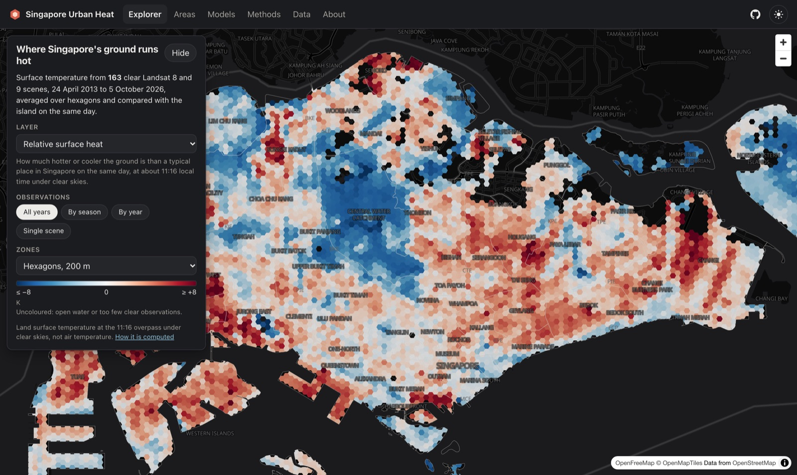
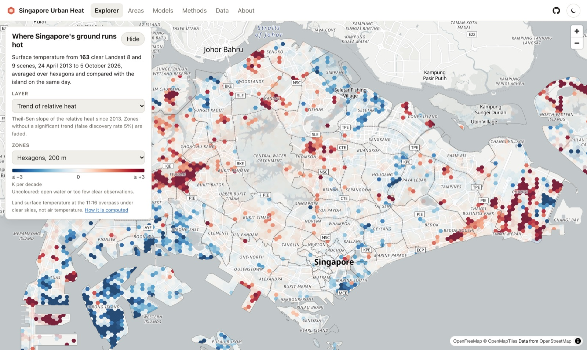
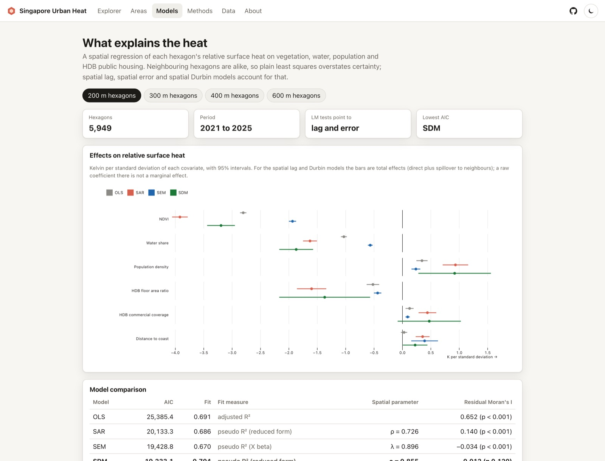
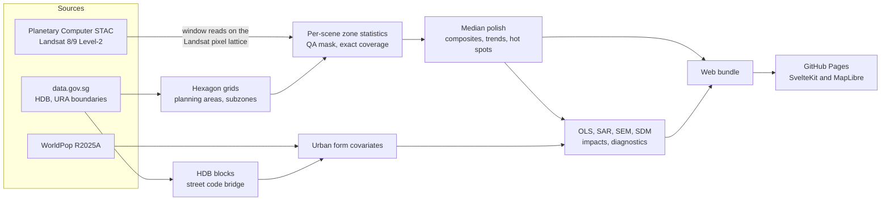

# Singapore Urban Heat

**Where Singapore's ground runs hot, why, and how that is changing: every clear Landsat 8 and 9 scene since 2013, spatial econometrics, and an interactive map that updates itself every month.**

[](https://github.com/mooofna/singapore-urban-heat/actions/workflows/ci.yml)
[](https://github.com/mooofna/singapore-urban-heat/actions/workflows/data-update.yml)
[](pyproject.toml)
[](LICENSE)
[](DATA_LICENSE.md)

**[Open the explorer](https://mooofna.github.io/singapore-urban-heat/)** | [Methods](docs/methodology.md) | [Data release](https://github.com/mooofna/singapore-urban-heat/releases/tag/data-latest)

[](https://mooofna.github.io/singapore-urban-heat/)

## What it does

* **Measures** land surface temperature from the USGS Level-2 product of every Landsat 8 and 9 scene over Singapore, with clouds, shadows and water masked per pixel, fetched through the Microsoft Planetary Computer STAC API.
* **Separates where from when**: a robust two-way decomposition turns patchy, cloud-dependent observations into a relative heat value per 200 m hexagon that is comparable across the island, plus seasonal and yearly composites and per-hexagon trends.
* **Explains** that heat with vegetation, water, population and the height and density of public housing in spatial lag, spatial error and spatial Durbin models, reported with direct and spillover effects.
* **Publishes** everything as a static website on GitHub Pages. A scheduled workflow checks for new scenes every month, reprocesses only what is new, validates the results and redeploys.

## Findings

Numbers below are generated from [`results/summary.json`](results/summary.json); the live site always shows the latest data.

<!-- results:start -->
* **163 usable scenes** out of 287 Landsat 8 and 9 acquisitions (2013-04-24 to 2026-10-05); a hexagon of the 200 m grid is clear in a median of 80 of them.
* On a clear late morning the ground averages about **38.8 °C**. The hottest tenth of the island is at least 4.7 K above the island level, the coolest tenth at least 5.4 K below it.
* The greenest tenth of hexagons is 5.5 K cooler than the island level (median), the least green tenth 2.0 K warmer.
* Hottest planning areas: Pioneer (+5.6 K), Boon Lay (+4.0 K), Serangoon (+2.6 K). Coolest: Central Water Catchment (−6.3 K), Simpang (−5.2 K), North-Eastern Islands (−4.8 K).
* 596 hexagons warmed and 561 cooled significantly relative to the island since 2013 (of 6,849 tested, false discovery rate 5%), for example where Tengah new town replaced forest.
* In the SDM on 5,949 hexagons, one standard deviation more NDVI (0.19) goes with −1.93 K locally and −3.20 K including spillover to neighbours; more HDB floor area per land area (0.63 per standard deviation) with −0.50 K, and denser population (16.9 thousand per km²) with +0.25 K. Residual Moran's I is −0.012.
* Skipping the atmospheric correction, as the original course version did, biases surface temperature by −8.7 to −16.9 K across 6 test scenes (−16.9 K on 2018-05-24).
<!-- results:end -->

These are associations at about 11:16 local time under clear skies, for surfaces rather than air. The [methods](docs/methodology.md#limitations) list every limitation.

| Trend of relative heat since 2013 | Effects in the spatial models |
| --- | --- |
| [](https://mooofna.github.io/singapore-urban-heat/?layer=trend) | [](https://mooofna.github.io/singapore-urban-heat/models) |

## How it works



The pipeline is a typed Python package (`sgheat`) with one command per stage:

```bash
uv sync
uv run sgheat run                      # everything below, about 10 minutes on a laptop
uv run sgheat fetch                    # data.gov.sg and WorldPop downloads with provenance
uv run sgheat boundaries && uv run sgheat buildings && uv run sgheat grid
uv run sgheat scenes discover          # STAC search, catalog in data/catalog/scenes.csv
uv run sgheat scenes process           # cloud screening and zone statistics per scene
uv run sgheat temporal                 # median polish, composites, trends, LISA
uv run sgheat features && uv run sgheat model
uv run sgheat physics                  # textbook LST against the USGS product
uv run sgheat export && uv run sgheat validate
uv run sgheat update                   # incremental monthly run used by the workflow
```

Then start the website against the generated data:

```bash
cd web && npm ci && npm run dev
```

No account or API key is needed. Every downloaded file and every artifact gets a provenance record with checksums, upstream versions, the config digest and the git commit.

## Design choices worth knowing

* **No resampling of temperature.** The analysis grid shares the Landsat pixel lattice (edges at 15 m modulo 30 m in UTM 48N), so scenes are read as integer windows from Cloud Optimized GeoTIFFs.
* **Exact, mass-conserving zonal statistics.** A sparse coverage matrix from exactextract turns every per-scene statistic into one sparse matrix product; population sums are conserved to machine precision.
* **Stable hexagon identifiers.** Axial coordinates anchored at the UTM origin, with integer vertex arithmetic so neighbours share bit-identical edges; the analytic adjacency is tested against polygon contiguity.
* **Honest spatial statistics.** Fit measures that do not borrow the neighbours' observed outcome, filtered residuals for the error model, impacts with Monte Carlo standard errors, and comparisons only between models fitted to the same data.
* **Physics you can check.** The textbook derivation (Planck inversion, emissivity, radiative transfer) is kept and validated against `ST_B10`, which shows why the atmospheric correction is not optional over Singapore.

## Quality

* `mypy --strict`, `ruff`, and a house-style check in pre-commit and CI; secret scanning with gitleaks and CodeQL.
* Unit tests for the physics, QA bit decoding, grid geometry, zonal statistics, temporal decomposition and spatial models on synthetic processes with known parameters.
* An offline end-to-end test runs the whole pipeline on a 6 km window of a real scene plus synthetic scenes with clouds and a planted warming trend, and checks that the trend is recovered.
* Playwright end-to-end and axe accessibility tests of the website on desktop and mobile.
* Weekly checks that the upstream APIs still behave as expected.

## Repository layout

```
src/sgheat/       physics, geo, io, temporal, stats, buildings, stages, export, cli
tests/            unit, integration (offline end-to-end), network (upstream contracts)
web/              SvelteKit app: explorer, areas, models, methods, data
docs/             methodology
configs/          default configuration
data/catalog/     scene catalog, updated by the monthly workflow
data/reference/   HDB street code bridge
results/          frozen headline numbers behind this README
```

## Origin

The project began as a course project in data science at Nanyang Technological University in 2025, which used a single Landsat scene from 24 May 2018 to replicate [Yong and Lim (2020)](https://arxiv.org/abs/2012.03049). This repository is a complete rewrite; the [methods](docs/methodology.md#changes-from-the-course-version) list what changed and why.

## Data and licences

Landsat data courtesy of the U.S. Geological Survey. Contains information from HDB Property Information, HDB Existing Building and the URA Master Plan 2019 boundaries accessed from data.gov.sg, made available under the Singapore Open Data Licence version 1.0. Population from WorldPop (CC BY 4.0). Basemap by OpenFreeMap, OpenMapTiles and OpenStreetMap contributors. Code is MIT licensed; derived data are CC BY 4.0, see [DATA_LICENSE.md](DATA_LICENSE.md).

## Citation

If you use this work, please cite it via [CITATION.cff](CITATION.cff) (GitHub shows a "Cite this repository" button).
